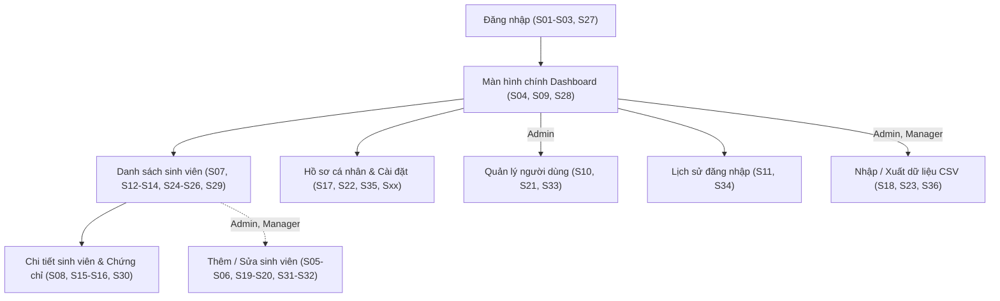

# Thiết Kế Hệ Thống & Kiến Trúc Kỹ Thuật

Các biểu đồ UML (use case, lớp, ER, tuần tự) nằm ở [`uml.md`](uml.md). Cấu trúc dữ liệu Firestore chuẩn nằm ở [`firestore-schema.md`](firestore-schema.md).
Đặc tả chi tiết toàn bộ hệ thống giao diện, design tokens, chuyển động và 36 màn hình đã được chuyển giao và chuẩn hóa hoàn toàn tại thư mục [`docs/design/`](design/README.md).

> **Trạng thái:** Kiến trúc MVVM, phân chia package-by-feature, quy chuẩn đặt tên và các giao ước bảo mật trong tài liệu này là chuẩn kỹ thuật chính thức của dự án.

## 1. Kiến trúc MVVM

```
┌─────────────────────────────────────────┐
│           Tầng Giao diện (UI)           │
│  Activities / Fragments / Adapters      │
└──────────────┬──────────────────────────┘
               │ observe LiveData
┌──────────────▼──────────────────────────┐
│          ViewModel                      │
│  Xử lý logic UI, giữ trạng thái         │
└──────────────┬──────────────────────────┘
               │ gọi
┌──────────────▼──────────────────────────┐
│          Repository                     │
│  Trung gian giữa ViewModel & Firebase   │
└──────────────┬──────────────────────────┘
               │ gọi SDK
┌──────────────▼──────────────────────────┐
│  Firebase Auth / Firestore / Storage    │
└─────────────────────────────────────────┘
```

Ứng dụng dùng **hai Activity**: `LoginActivity` (đăng nhập) và `MainActivity` (chứa Navigation Component, các màn hình còn lại là Fragment). Mọi thao tác Firebase nằm trong Repository.

## 2. Phân chia package thực tế (`com.example.studentmgmt`)

Dự án áp dụng mô hình tổ chức **Package-by-Feature** kết hợp với **Clean Architecture & Dependency Inversion** (khuyên dùng bởi Google Android Architecture Guide) thay cho việc phân chia Layer phẳng:

| Package | Tệp tin / Lớp thành phần | Vai trò kiến trúc |
|---|---|---|
| `model/` | `AppUser`, `Student`, `Certificate`, `LoginRecord`, `UiState<T>` | Định nghĩa thực thể dữ liệu nghiệp vụ và trạng thái giao diện chuẩn (`LOADING`, `CONTENT`, `EMPTY`, `ERROR`). Đổi tên `User` thành `AppUser` để tránh xung đột với `FirebaseUser`. |
| `data/` | **Interfaces:** `AuthRepository`, `UserRepository`, `StudentRepository`, `CertificateRepository`, `ProfileRepository`, `LoginHistoryRepository`<br>**Providers:** `*Provider.java` (Dependency Inversion)<br>**Firebase Impl:** `FirebaseAuthRepository`, `FirestoreUserRepository`, `FirebaseProfileRepository`, `FirebaseLoginHistoryRepository`<br>**Mock Impl:** `MockStudentRepository`, `MockCertificateRepository`<br>**Validators:** `UserDocumentValidator`, `DefaultUsernameAuthResolver` | Tầng trừu tượng dữ liệu và truy cập Firebase Cloud / bộ nhớ đệm in-memory. Cung cấp cơ chế Provider để dễ dàng mock dữ liệu khi chạy Unit Tests độc lập. |
| `ui/auth/` | `LoginActivity`, `LoginViewModel` | Màn hình đăng nhập bằng username/mật khẩu, xử lý trạng thái đăng nhập, xác thực tenant domain và quản lý phiên. |
| `ui/student/` | `StudentListFragment`, `StudentDetailFragment`, `StudentListViewModel`, `StudentDetailViewModel`, `StudentAdapter`, `CertificateAdapter` | Danh sách sinh viên realtime, tìm kiếm tiếng Việt có dấu, lọc theo Khoa, xem chi tiết và danh sách chứng chỉ con. Form thêm/sửa tích hợp qua Material Dialog (`dialog_student_add_edit.xml`, `dialog_certificate_add.xml`). |
| `ui/user/` | `UserListFragment`, `UserManagementViewModel`, `UserAdapter`, `UserManagementPolicy` | Danh sách người dùng dành cho Admin, đổi vai trò, khóa/mở khóa tài khoản, form thêm/sửa qua `dialog_user_edit.xml`. |
| `ui/profile/` | `ProfileFragment`, `ProfileViewModel`, `AvatarUploadPolicy` | Xem hồ sơ cá nhân, đổi ảnh đại diện (giới hạn < 5MB, JPG/PNG), hỗ trợ Local Storage Fallback khi chưa kích hoạt Cloud Storage bucket. |
| `ui/history/` | `LoginHistoryFragment`, `LoginHistoryViewModel`, `LoginHistoryAdapter`, `LoginHistoryPolicy` | Ghi nhận thời gian thực và xem lịch sử đăng nhập (Admin xem toàn bộ, người dùng thường xem của chính mình). |
| `ui/navigation/` | `RoleNavigationPolicy`, `SessionSecurityPolicy` | Chính sách phân quyền menu hiển thị theo 3 vai trò và cơ chế lắng nghe realtime để cưỡng chế đăng xuất ngay khi tài khoản bị khóa (`Locked`). |
| `ui/placeholder/` | `StudentPlaceholderFragment`, `UserManagementPlaceholderFragment`, `ProfilePlaceholderFragment` | Các Fragment giữ chỗ điều hướng giúp đảm bảo ranh giới làm việc độc lập và ứng dụng luôn build thành công giữa 2 thành viên. |
| `utils/` | `ValidationUtils`, `StudentCsvHelper` | Kiểm tra định dạng MSSV (`KYYTSSSS`), mã lớp, phone, username; Xử lý xuất/nhập tệp CSV chuẩn UTF-8 có BOM. |

> [!NOTE]
> **Điểm tiến hóa kiến trúc so với dự thảo ban đầu:**
> 1. **Package-by-Feature:** Gom các ViewModel, Adapter và Policy đi kèm trực tiếp với màn hình tương ứng (`ui/student`, `ui/user`, `ui/history`) thay vì trải phẳng ra các package `adapter/` hay `viewmodel/` rời rạc. Điều này giúp dễ bảo trì và tăng tính đóng gói.
> 2. **Material Dialogs & Screen Specs:** Form Thêm/Sửa được chuẩn hóa với Material Dialogs và chi tiết hóa toàn diện tại bộ 36 màn hình trong [docs/design/screens/](design/screens/).
> 3. **AppUser:** Đổi tên từ `User` thành `AppUser` để tránh nhầm lẫn trực tiếp với lớp `FirebaseUser` có sẵn trong SDK Firebase Authentication.

---

## 3. Hệ thống Giao diện & Điều hướng (Design System)

Toàn bộ đặc tả giao diện dạng sơ bộ trước đây đã được thay thế hoàn toàn bằng **Bộ tài liệu Design System chuẩn hóa** tại thư mục [`docs/design/`](design/README.md), bao gồm:

- **Hệ thống Design Tokens:** [Màu sắc Light/Night](design/tokens/colors.xml), [Kích thước & Padding](design/tokens/dimens.xml), [Typography](design/tokens/typography.md).
- **Hệ thống Hiệu ứng chuyển động (Motion):** [Motion Tokens](design/motion-tokens.md), [Motion Policy](design/motion-policy.md), và [11 hiệu ứng FX-01 → FX-11](design/motion-effects.md).
- **Đặc tả 36 màn hình (S01 → S36):** Xem chi tiết tại thư mục [docs/design/screens/](design/screens/) kèm hình ảnh trực quan tại [docs/design/reference/](design/reference/).
- **Bộ chuỗi hiển thị chuẩn:** [strings-vi.xml](design/strings-vi.xml).
- **Ma trận trạng thái giao diện & Phân tích khoảng cách:** [state-matrix.md](design/states/state-matrix.md) và [gap-analysis.md](design/gap-analysis.md).



*Hình: Sơ đồ điều hướng phân quyền chuẩn của ứng dụng theo Design System.*

## 4. Quy ước thiết kế & Bảo mật

- **Ẩn chức năng theo vai trò:** `RoleNavigationPolicy` quyết định hiện hoặc ẩn menu; giao diện ẩn nút thêm/sửa/xóa đối với vai trò `Employee`. Tầng dữ liệu đám mây được bảo vệ bởi `firestore.rules`.
- **Kiểm tra `Locked`:** Sau khi đăng nhập Auth, `SessionSecurityPolicy` kiểm tra ngay `users/{uid}.status`. Nếu là `Locked`, hệ thống cưỡng chế đăng xuất ngay và quay lại màn hình Login.
- **Cấp Admin đầu tiên:** Được tạo từ Firebase Console hoặc môi trường máy chủ tin cậy; ứng dụng client không tự cấp quyền Admin.
- **Admin tạo người dùng:** Username là bắt buộc, email là tùy chọn; `UserDocumentValidator` kiểm tra nghiêm ngặt giới hạn tuổi 18–60 (trên kiểu 64-bit tránh tràn số), số điện thoại 10 số.
- **Tìm kiếm/sắp xếp:** Xử lý tức thì trên client trên danh sách lắng nghe snapshot theo thời gian thực (hỗ trợ Unicode tiếng Việt chuẩn).
- **Trạng thái ngoại tuyến:** Tự động lưu cache Firestore; hiển thị thông báo và nút "Thử lại" khi mất kết nối mạng.

---

## 5. Quy ước đặt tên & Chuẩn viết mã (Coding & Naming Conventions)

Để đảm bảo nhóm 2 người phát triển độc lập không bị xung đột phong cách mã nguồn, toàn bộ dự án tuân thủ nghiêm ngặt các quy tắc sau:

### 5.1 Ngôn ngữ & Phong cách chung
- **Mã nguồn (Java/Kotlin, Class, Method, Variable, DB):** Sử dụng **tiếng Anh 100%**. Tuyệt đối không đặt tên biến hoặc lớp lai tạp (ví dụ: không dùng `SinhVien`, `chungChiList`, `tenSinhVien`).
- **Giao diện người dùng (UI String, Toast, Dialog, Lỗi):** Sử dụng **tiếng Việt có dấu**, lịch sự, rõ nghĩa (định nghĩa trong `res/values/strings.xml`).

---

### 5.2 Quy ước đặt tên Lớp, Giao diện & Enum (PascalCase)

| Thành phần | Quy tắc đặt tên | Ví dụ thực tế |
|---|---|---|
| **Model / Entity** | Danh từ đơn số chỉ đối tượng dữ liệu | `AppUser`, `Student`, `Certificate`, `LoginRecord`, `UiState` |
| **Repository** | `{Entity}Repository` | `AuthRepository`, `UserRepository`, `StudentRepository`, `CertificateRepository` |
| **ViewModel** | `{Feature/Entity}ViewModel` | `LoginViewModel`, `UserManagementViewModel`, `StudentListViewModel`, `ProfileViewModel` |
| **Activity** | `{Feature}Activity` | `LoginActivity`, `MainActivity` |
| **Fragment** | `{Feature/Action}Fragment` | `StudentListFragment`, `StudentDetailFragment`, `UserListFragment`, `ProfileFragment` |
| **Adapter (RecyclerView)** | `{Entity}Adapter` | `StudentAdapter`, `CertificateAdapter`, `UserAdapter`, `LoginHistoryAdapter` |
| **Helper / Utility** | `{Chức năng}Helper` hoặc `{Chức năng}Utils` | `StudentCsvHelper`, `ValidationUtils`, `DefaultUsernameAuthResolver` |
| **Policy / Guard** | `{Domain}Policy` | `RoleNavigationPolicy`, `SessionSecurityPolicy`, `AvatarUploadPolicy` |
| **Enum / Value Type** | Danh từ số ít, giá trị viết HOA hoặc chuỗi hằng số | Vai trò (`admin`, `manager`, `employee`), Trạng thái (`Normal`, `Locked`) |

---

### 5.3 Quy ước đặt tên Phương thức / Hàm (camelCase, Động từ + Danh từ)

- **Lấy dữ liệu:** Bắt đầu bằng `get...`, `fetch...`, `observe...` (ví dụ: `getStudentById(String id)`, `observeStudentsRealtime()`).
- **Thao tác ghi (C/U/D):** Bắt đầu bằng `add...`, `create...`, `update...`, `delete...` (ví dụ: `addStudent(Student s)`, `updateUserStatus(String uid, UserStatus status)`, `deleteStudentCascade(String id)`).
- **Kiểm tra trạng thái (Trả về Boolean):** Bắt đầu bằng `is...`, `has...`, `can...` (ví dụ: `isLocked()`, `hasWritePermission(UserRole role)`, `isValidEmail(String email)`).
- **Sự kiện UI / Listener:** Bắt đầu bằng `on...` hoặc `handle...` (ví dụ: `onLoginClicked()`, `onStudentSelected(Student s)`, `handleCsvImport(Uri uri)`).

---

### 5.4 Quy ước đặt tên Biến & Hằng số

| Loại định danh | Quy ước | Ví dụ |
|---|---|---|
| **Biến cục bộ / Thuộc tính** | camelCase | `studentList`, `currentUser`, `selectedStudentId`, `searchQuery` |
| **Biến trạng thái (Boolean)** | camelCase với tiền tố `is/has/isLoading` | `isLoading`, `isLocked`, `isSearchActive` |
| **Hằng số tĩnh (static final / const)** | UPPER_SNAKE_CASE | `MAX_BATCH_SIZE = 400`, `DEFAULT_PAGE_SIZE = 20`, `DATE_FORMAT = "dd/MM/yyyy"` |
| **Collection Firestore** | UPPER_SNAKE_CASE | `COLLECTION_USERS = "users"`, `COLLECTION_STUDENTS = "students"`, `SUB_CERTIFICATES = "certificates"` |

---

### 5.5 Quy ước đặt tên Trường CSDL Firestore (camelCase)

Tất cả document field trong Cloud Firestore đều dùng **camelCase**, thống nhất giữa CSDL và Model:
- **`users`:** `uid`, `username`, `email` (tùy chọn), `name`, `age`, `phone`, `status`, `role`, `avatarUrl`, `createdAt`
- **`students`:** `studentId`, `name`, `dateOfBirth`, `className`, `faculty`, `createdAt`
- **`certificates`:** `certName`, `issueDate`, `issuedBy`
- **`loginHistory`:** `timestamp`, `device`

`studentId` là document ID, khớp `^[0-9A-H][0-9]{2}[0H][0-9]{4}$`; `className` khớp `^[0-9A-Z]{8}$`. Ứng dụng chỉ kiểm tra, không tự sinh MSSV.

---

### 5.6 Quy ước đặt tên Tài nguyên Android (XML Resource - snake_case)

#### 1. Tệp Giao diện (Layout XML): `{tiền tố}_{tên màn hình}.xml`
- Activity: `activity_login.xml`, `activity_main.xml`
- Fragment: `fragment_student_list.xml`, `fragment_student_detail.xml`, `fragment_user_list.xml`, `fragment_profile.xml`
- Item RecyclerView: `item_student.xml`, `item_certificate.xml`, `item_user.xml`, `item_login_record.xml`
- Dialog: `dialog_filter_student.xml`, `dialog_confirm_delete.xml`

#### 2. Định danh ID trong Layout: `{tiền tố view}_{mục đích}`
- **Button:** `btn_login`, `btn_save`, `btn_cancel`, `btn_import_csv`
- **TextInput / EditText:** `edt_login_identifier`, `edt_email`, `edt_password`, `edt_student_id`, `edt_student_name`, `edt_phone`
- **TextView:** `tv_title`, `tv_student_name`, `tv_class_name`, `tv_role`, `tv_status`
- **RecyclerView:** `rv_students`, `rv_certificates`, `rv_users`
- **ImageView:** `img_avatar`, `img_icon_search`
- **ProgressBar / Skeleton:** `pb_loading`, `skeleton_container`
- **FloatingActionButton:** `fab_add_student`, `fab_add_certificate`

#### 3. Tệp Drawable, Color & String
- Icon: `ic_search.xml`, `ic_filter.xml`, `ic_add.xml`, `ic_edit.xml`, `ic_delete.xml`
- Background: `bg_rounded_card.xml`, `bg_badge_locked.xml`
- Color: `color_primary`, `color_secondary`, `color_status_locked`, `color_status_normal`
